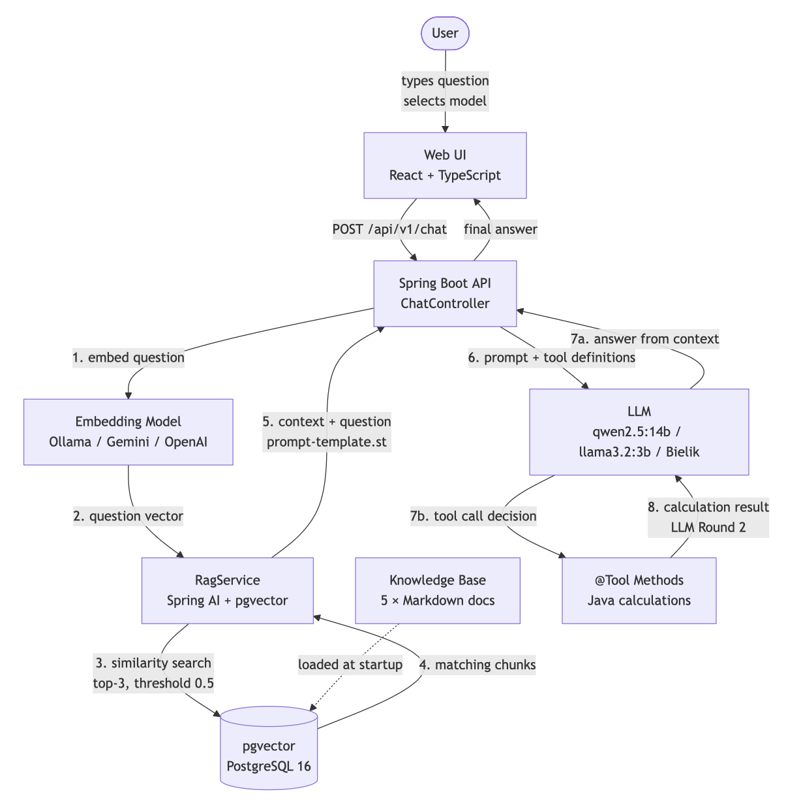
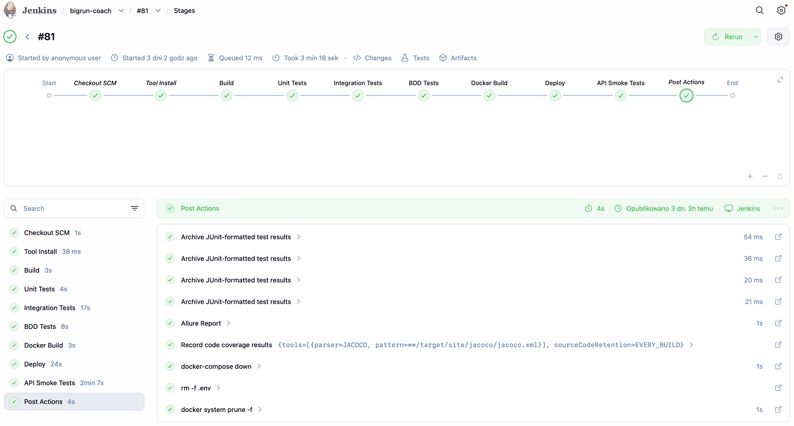
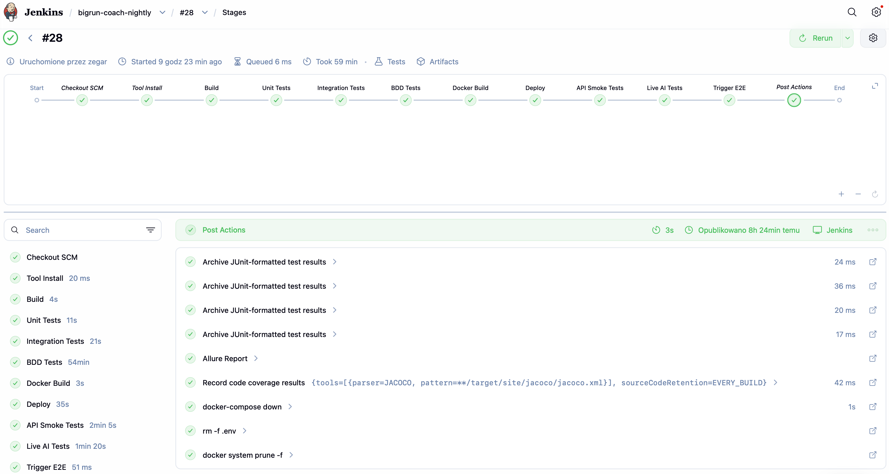
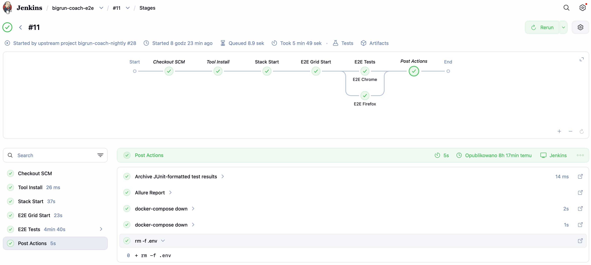

# BigRun Coach

> AI chat assistant for runners.
> 
> Ask about training, pace, nutrition, injuries, or marathon prep —
> the app retrieves relevant answers from a curated knowledge base (RAG) and performs calculations
> via Tool Calling (`@Tool` methods for pace and hydration).
>
> Portfolio project built with Java 21 · Spring Boot 3.5 · Spring AI 1.1 · React 19.
> 
> Covered by a 5-level test suite: unit (JUnit 5 + Mockito), integration (TestContainers + WireMock),
> BDD (Cucumber + Gherkin), API smoke (Newman), and UI E2E (Selenium 4 + Grid, 3 browsers).
> 
> CI/CD delivered via 3 Jenkins pipelines: daily commit pipeline, nightly pipeline with live AI tests,
> and a dedicated E2E pipeline running Selenium in parallel on Chrome and Firefox.

## What this project demonstrates

| Area | Technology                                    | Pattern |
|------|-----------------------------------------------|---------|
| **AI / RAG** | Spring AI + pgvector                          | vector similarity search → context injection → LLM |
| **Tool Calling** | `@Tool` annotation                            | LLM autonomously dispatches Java methods for calculations |
| **Multi-provider LLM** | Ollama / Gemini / OpenAI                      | zero-code switching via `.env` |
| **Polish LLM** | Bielik (SpeakLeash)                           | local open-source model, 3rd model option in UI |
| **Testing — 5 levels** | JUnit 5 / Cucumber / REST Assured / Newman / Selenium | unit → integration → BDD → API smoke → UI E2E |
| **CI/CD** | Jenkins (3 pipelines)                         | daily + nightly + parallel E2E on Selenium Grid |
| **Frontend** | React 19 + TypeScript + Vite                  | runtime model selection, dynamic config from backend |
| **DB Migrations** | Liquibase                                     | versioned schema, pgvector extension management |

---

## Repository structure

```
bigrun-coach/           # Backend — Spring Boot 3.5 / Java 21
bigrun-coach-ui/        # Frontend — React 19 + TypeScript + Vite
bigrun-coach-se/        # E2E tests — Selenium 4 + JUnit 5 + Grid
```

Each subproject has its own `README.md` with setup details.

---

## Architecture

### RAG + Tool Calling flow



### Multi-provider switching

Zero code changes — only `.env`:

| Provider | Models | Free |
|----------|--------|------|
| **Ollama** (default) | qwen2.5:14b · llama3.2:3b · Bielik | yes (local) |
| **Gemini** | gemini-2.0-flash | yes (1500 req/day) |
| **OpenAI** | gpt-4o-mini | no |

`bielikModel` is `null` in `/api/v1/config` response when Gemini/OpenAI is active — Bielik button disappears from UI automatically.

---

## Quick Start — Ollama (default, ~10 GB RAM)

**Requirements:** Docker Desktop, [Ollama](https://ollama.com)

```bash
git clone <repository-url>
cd bigrun-coach

cp bigrun-coach/.env.example bigrun-coach/.env
# fill in: DB_USERNAME, DB_PASSWORD
```

```bash
ollama pull qwen2.5:14b                                   # Smart model
ollama pull llama3.2:3b                                   # Fast model
ollama pull nomic-embed-text                              # Embedding model
ollama pull SpeakLeash/bielik-11b-v3.0-instruct:Q4_K_M  # Polish model (optional)
```

> Models used during development were chosen deliberately: **qwen2.5:14b** (large, high quality answers),
> **llama3.2:3b** (small, fast responses), and **Bielik** — a native Polish open-source LLM by
> [SpeakLeash](https://speakleash.org), demonstrating support for non-English models.
> Any Ollama-compatible model can be substituted — just update `OLLAMA_SMART_MODEL` / `OLLAMA_FAST_MODEL`
> / `OLLAMA_BIELIK_MODEL` in `.env` and pull the model first.

```bash
cd bigrun-coach && docker-compose up --build
```

With Ollama you get 3 model buttons in the UI: **Smart** · **Fast** · **Bielik**.


## Using the app


**Browser:** open `http://localhost:80`, select a model, type a question and send.

Example questions:
- *"How many km should I run per week as a beginner?"* — RAG answer from knowledge base
- *"What is my pace if I ran 10 km in 55 minutes?"* — triggers `@Tool` pace calculation
- *"How much should I drink during a marathon?"* — triggers `@Tool` hydration calculation

**API directly:**

```bash
# RAG — knowledge base answer
curl -X POST http://localhost:8081/api/v1/chat \
  -H "Content-Type: application/json" \
  -d '{"message": "How many km should I run per week as a beginner?", "model": "smart"}'

# Tool Calling — pace calculation
curl -X POST http://localhost:8081/api/v1/chat \
  -H "Content-Type: application/json" \
  -d '{"message": "What is my pace if I ran 10 km in 55 minutes?", "model": "fast"}'

# Active provider + available models
curl http://localhost:8081/api/v1/config
```

`model` values: `smart` · `fast` · `bielik` (Ollama only). Omit `model` to use the default (smart).

Full API reference: `http://localhost:8081/swagger-ui/index.html`

Backend logs showing Tool Calling in action:


---

## Quick Start — Gemini / OpenAI

> Gemini and OpenAI providers are configured and the project is architecturally prepared for them.
> Full multi-provider support is a planned milestone pending migration to Spring AI 2.x.

**Gemini** (free key at [aistudio.google.com](https://aistudio.google.com)):

```env
OLLAMA_ENABLED=false
GEMINI_ENABLED=true
GEMINI_API_KEY=<your-key>
GEMINI_CHAT_MODEL=gemini-2.0-flash
GEMINI_EMBEDDING_MODEL=text-embedding-004
```

**OpenAI** (paid, [platform.openai.com](https://platform.openai.com)):

```env
OLLAMA_ENABLED=false
OPENAI_ENABLED=true
OPENAI_API_KEY=<your-key>
OPENAI_CHAT_MODEL=gpt-4o-mini
OPENAI_EMBEDDING_MODEL=text-embedding-3-small
```

```bash
cd bigrun-coach && docker-compose up --build
```

| URL | Description |
|-----|-------------|
| http://localhost:80 | React chat UI |
| http://localhost:8081/swagger-ui/index.html | OpenAPI docs |
| http://localhost:8081/api/v1/config | Active provider JSON |

---

## Tech Stack

| Layer | Technology | Version |
|-------|-----------|---------|
| Language | Java | 21 |
| Framework | Spring Boot | 3.5.14 |
| AI Orchestration | Spring AI | 1.1.6 |
| Vector Store | PostgreSQL + pgvector | 16 |
| DB Migrations | Liquibase | 4.x |
| Frontend | React + TypeScript | 19 / 6.0.2 |
| Frontend Build | Vite + Tailwind CSS | 8.0.12 / 4.3.0 |
| E2E Browser Tests | Selenium Grid | 4.21.0 |
| CI/CD | Jenkins | 2.555.2 |

**Testing stack:**

| Tool | Role |
|------|------|
| JUnit 5 + Mockito | unit tests, service layer |
| TestContainers | real PostgreSQL in integration tests |
| WireMock | Ollama HTTP stubs (chat + embedding) |
| REST Assured | integration + E2E API tests |
| Cucumber 7 + Gherkin | BDD — 7 scenarios in Polish (`.feature`) |
| Selenium 4 + WebDriverManager | UI E2E — Chrome / Firefox |
| Page Object Model | `ChatPage.java` — all locators and helpers |
| AssertJ + Hamcrest | fluent assertions throughout |
| JaCoCo | code coverage — 50 % minimum enforced |
| Allure | test reports (backend + Selenium) |
| Newman (Postman CLI) | API smoke tests in CI pipeline |

---

## Testing strategy

**5 levels — 12 backend test classes + 7 Selenium test classes + Cucumber feature files + Newman collection.**


| Level | Framework | What is tested | AI required |
|-------|-----------|---------------|------------|
| **Unit** | JUnit 5 + Mockito | service logic, `@Tool` calculations | no |
| **Integration** | TestContainers + WireMock + REST Assured | RAG pipeline, REST endpoints | WireMock stubs Ollama |
| **BDD** | Cucumber 7 + Gherkin | 7 chat validation scenarios (Polish) | WireMock |
| **API Smoke** | Newman / Postman | happy path + config endpoint in CI | WireMock |
| **UI E2E** | Selenium 4 + JUnit 5 + Grid | browser flow, model selector, 2 browsers | running app |

Key patterns demonstrated:
- **WireMock stubs** — `ollama-chat-response.json` + `ollama-embed-response.json` decouple tests from real AI
- **`@MockitoBean KnowledgeLoader`** — prevents startup embedding calls in IT tests
- **`@Tag("live-ai")`** — live AI tests isolated in a separate Maven profile, run only on nightly
- **Page Object Model** — `ChatPage.java` with all Selenium locators and helper methods
- **JaCoCo 50 % minimum** — build fails if coverage drops below threshold
- **Allure reports** — generated for backend tests and Selenium E2E separately

See [`bigrun-coach/README.md`](bigrun-coach/README.md) for test commands.

---

## CI/CD

> Jenkins pipelines run locally — this is a portfolio project without public CI infrastructure.
> All three Jenkinsfiles are production-ready and can be connected to any Jenkins instance.


### `Jenkinsfile` — every commit

```
Build (mvn clean package)
  → Unit Tests (mvn test)
  → Integration Tests (mvn verify -P integration-tests)
  → BDD Tests (mvn verify -P cucumber)
  → Docker Build (Dockerfile.ci)
  → Deploy (docker-compose up -d --build)
  → API Smoke Tests (Newman / Postman collection)
```

Post: JUnit reports · Allure report · JaCoCo coverage · docker-compose down · docker system prune




### `Jenkinsfile.nightly` — cron 2:00 AM

All stages from `Jenkinsfile` plus:
```
  → Live AI Tests (mvn verify -P live-ai, Ollama on host.docker.internal)
  → Trigger E2E (triggers bigrun-coach-e2e job)
```




### `Jenkinsfile.e2e` — triggered by nightly

```
Stack Start (docker-compose up --build)
  → E2E Grid Start (Selenium Hub + Chrome + Firefox)
  → E2E Chrome  ─┐
                  ├─ parallel
  → E2E Firefox ─┘
```

Post: JUnit reports · Allure report · Selenium Grid down · Stack down



Secrets (`db-name`, `db-username`, `db-password`, `ollama-base-url`) stored in Jenkins Credentials Store — never in code or `.env` in CI.
